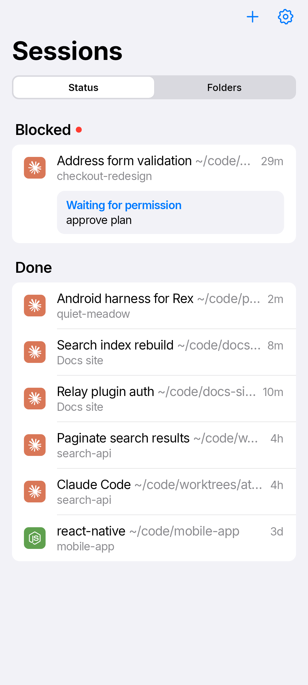
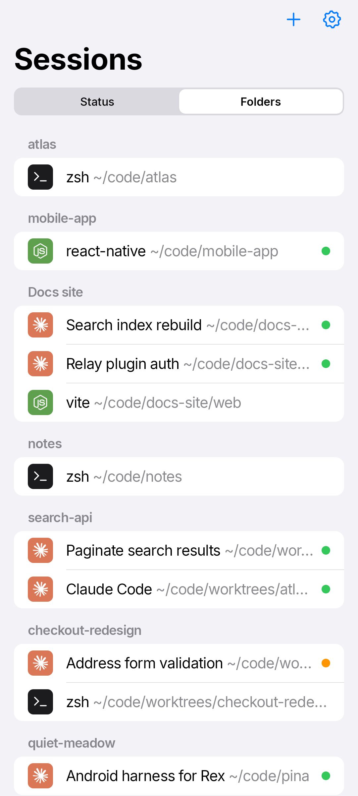
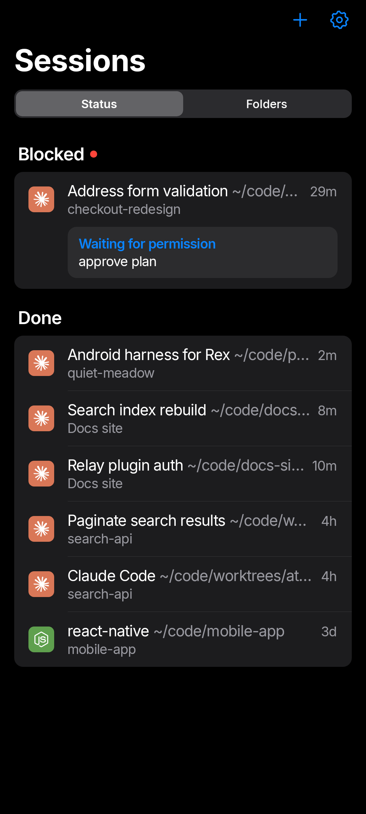
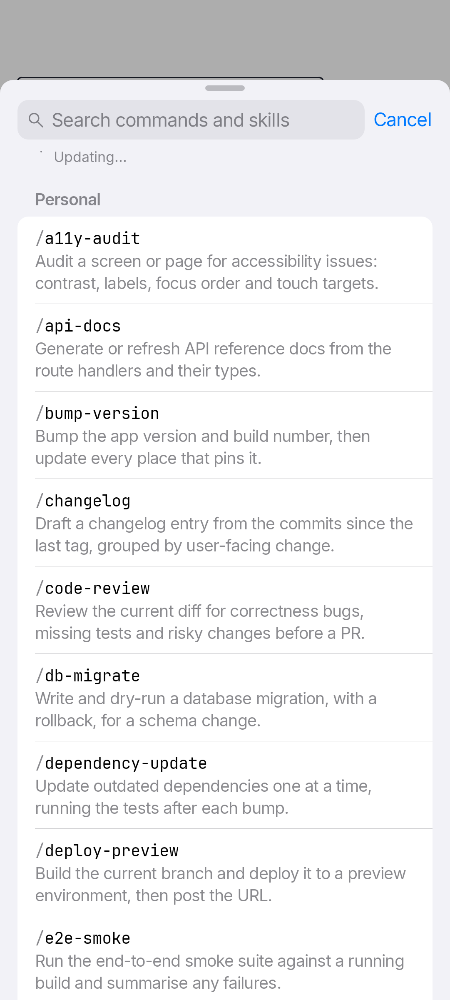
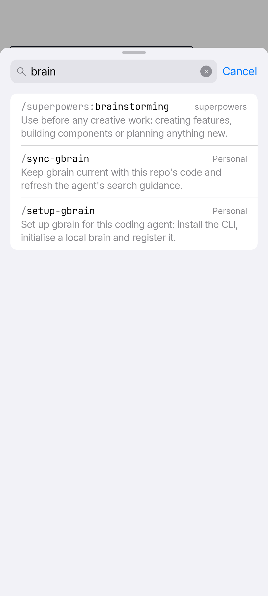
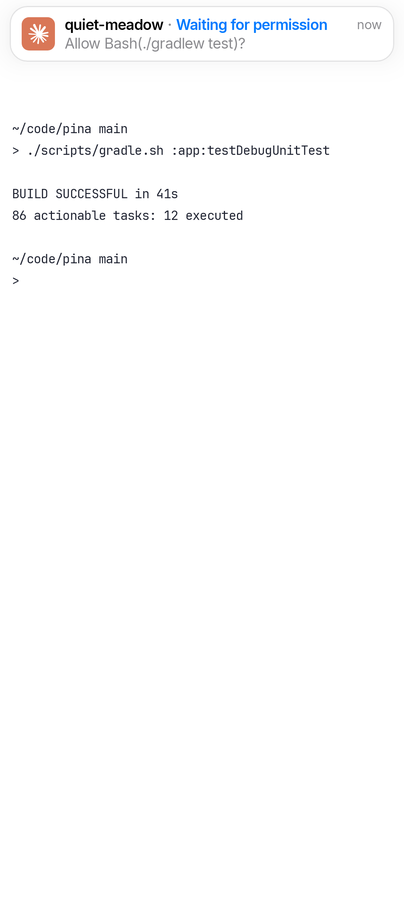
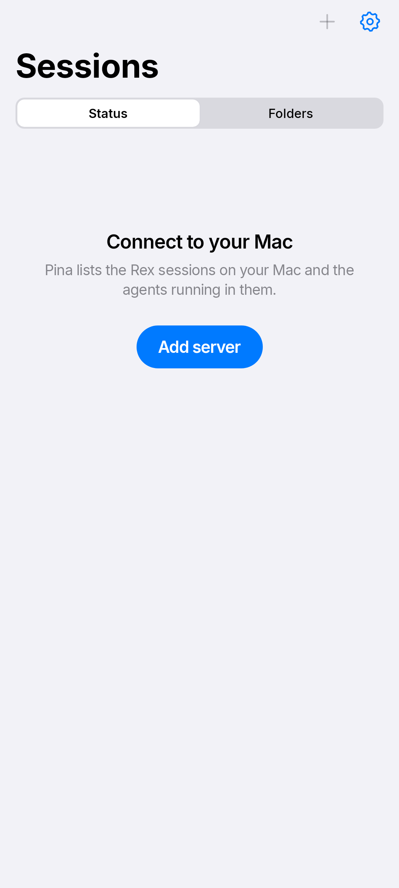
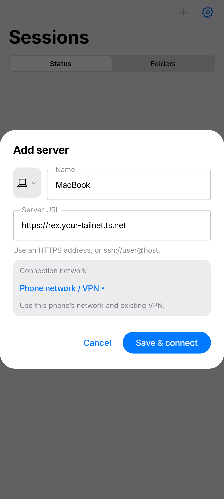
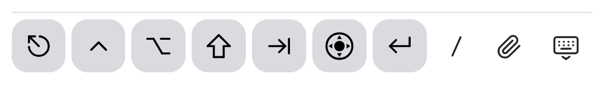

#  Pina

Pina is an Android app for keeping up with the Claude Code sessions you run in [Rex](https://www.superlogical.com/rex) on your Mac. It lists every agent by what it needs from you, notifies you when one finishes or is waiting for input, and opens its terminal when you tap it. It looks like Rex on the Mac, in light or dark.

| Sessions by status | Sessions by folder | Dark mode |
| :---: | :---: | :---: |
|  |  |  |

## What Pina does

- **See every agent at a glance.** Claude Code panes are grouped as Blocked, Working, Error, Done, and Idle, and each row shows the pane's name. A blocked agent shows what it is waiting for, such as "Waiting for permission: approve plan".
- **Switch to folders.** Tap **Folders** to see every terminal grouped by Rex session, the way the Rex sidebar does.
- **Get notified.** Pina tells you when an agent finishes, needs permission, asks a question, or fails. Tap the notification to open that pane. While you work in one terminal, a banner tells you when another agent needs you.
- **Use your skills.** Type `/` in a Claude Code prompt, or tap the `/` key, to search Claude Code's commands and every skill installed on your Mac, including plugin and project skills.
- **Send files to Claude.** Tap the paperclip to send any file from your phone. Rex saves it on your Mac and types its path into the prompt.
- **Use the full terminal.** Each pane is a real terminal, with keys for Ctrl, arrows, Tab, and Esc.

| Slash commands | Search | Agent banner |
| :---: | :---: | :---: |
|  |  |  |

## Set up Pina

Setup takes about 10 minutes. You need:

- A Mac running Rex.
- A free [Tailscale](https://tailscale.com) account. Tailscale connects your phone to your Mac from anywhere, without opening a port to the internet.
- An Android phone with Android 9 or later, on a 64-bit ARM chip. Most phones from 2019 onward qualify.

### Step 1. Turn on HTTPS for your tailnet

Rex serves its connection over HTTPS, so your tailnet needs certificates.

1. Open the [DNS page](https://login.tailscale.com/admin/dns) of the Tailscale admin console.
2. If **MagicDNS** is off, click **Enable MagicDNS**.
3. Under **HTTPS Certificates**, click **Enable HTTPS**.

### Step 2. Serve Rex over Tailscale

Do this on your Mac.

1. In Rex, open **Settings** and go to the Tailscale section.
2. Turn on **Serve over Tailscale**.
3. The first time, Rex asks you to sign in. Open the link and approve the new device. It appears in your tailnet as `rex`.
4. Leave **Limit access to your Tailscale account** on, so only you can reach your terminals.
5. Find your server address. In Rex, choose **Pair Device with QR Code**, or run this in a terminal:

   ```sh
   rex server tailscale pair --json
   ```

   The address looks like `https://rex.your-tailnet.ts.net`. Keep it for step 5.

### Step 3. Put your phone on your tailnet

1. Install [Tailscale](https://play.google.com/store/apps/details?id=com.tailscale.ipn) from Google Play.
2. Sign in with the same account you used on your Mac.
3. Tap **Connect**. In the Tailscale app, your Mac's `rex` device now appears in the device list.

### Step 4. Install Pina

1. On your phone, open the [latest release](https://github.com/JDLegaspi/pina/releases/latest) and download the `.apk` file.
2. Open the downloaded file. If Android asks, allow your browser to install unknown apps.
3. Tap **Install**.

If installation is blocked on a Samsung phone, **Auto Blocker** is on. Go to **Settings → Security and privacy → Auto Blocker**, turn it off, install Pina, and then turn it back on.

### Step 5. Add your Mac

| Open Pina | Add your server |
| :---: | :---: |
|  |  |

1. Open Pina and tap **Add server**.
2. In **Name**, type a name for your Mac, such as `MacBook`.
3. In **Server URL**, paste the address from step 2, such as `https://rex.your-tailnet.ts.net`.
4. Leave **Connection network** set to **Phone network / VPN**.
5. Tap **Save & connect**.

Your sessions appear within a few seconds. On Android 17 or later, allow local network access if Android asks.

### Step 6. Turn on notifications

When Pina asks, tap **Turn On**, and then allow notifications. To change this later, tap the gear and open **Preferences**.

Something not working? [Connect Pina to Rex over Tailscale](docs/tailscale.md) covers each step in more detail and lists fixes for common errors. Pina can also connect over SSH, and has its own built-in Tailscale if you would rather not install the Tailscale app. See [connection options](docs/connections.md).

## Use Pina

- **Open an agent.** Tap a row to open its terminal. Tap **←** in the header to return to your sessions.
- **Run a skill.** Type `/` at an empty Claude Code prompt, or tap **/** in the key bar. Search, tap a command, and Pina types it into the prompt. Add any arguments, then press Enter.
- **Send a file.** Tap the paperclip in the key bar and choose one or more files. Pina uploads them to your Mac and types their paths into the prompt, ready for you to send.
- **Change the look.** Tap the gear, then **Preferences → Appearance**, and choose **System**, **Light**, or **Dark**.



## Build from source

You need macOS on Apple silicon or x86_64 Linux, with Python 3, curl, Go, and JDK 25. The setup script installs the rest: Rust with the Android target, Android SDK platform 37, build tools 36, and NDK 30.

```sh
git clone https://github.com/JDLegaspi/pina.git
cd pina
./scripts/setup-toolchain.sh
export JAVA_HOME=/path/to/jdk-25 ANDROID_HOME="$HOME/Library/Android/sdk" PATH="$HOME/.cargo/bin:$PATH"
./rexling-android/scripts/gradle.sh :app:shareRelease
```

The APK is in `rexling-android/dist/`. To install it on a phone with USB or wireless debugging turned on, run:

```sh
adb install -r rexling-android/dist/Pina-*.apk
```

The first build downloads Zig and Ghostty's source and takes several minutes. [BUILDING.md](BUILDING.md) lists exact versions and the checks you can run without a phone.

To run the tests and re-record the screenshots in this README, run:

```sh
./rexling-android/scripts/gradle.sh :app:testDebugUnitTest :app:recordRoborazziDebug
```

## How it works

Pina is a fork of [Rexling](https://github.com/shulhi/rexling). A Rust core speaks Rex's WebSocket API and renders terminals with libghostty. A Go module provides SSH and built-in Tailscale. Pina's sessions screen, notifications, command picker, uploads, and Apple-style design sit in the Kotlin and Compose app on top. [docs/pina/DESIGN.md](docs/pina/DESIGN.md) records each design decision and why it was made.

## License

Pina is licensed under the [Apache License 2.0](LICENSE), like Rexling, which it is based on: Copyright 2026 Shulhi Sapli and contributors. Pina is an independent, unofficial client. It is not affiliated with Superlogical or Anthropic. Third-party components, including the Inter font (SIL Open Font License), keep their own terms. See [THIRD_PARTY_NOTICES.md](THIRD_PARTY_NOTICES.md).
